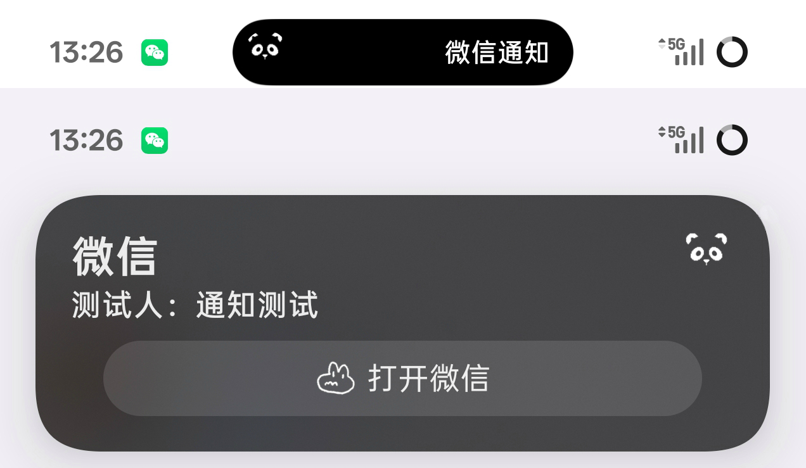
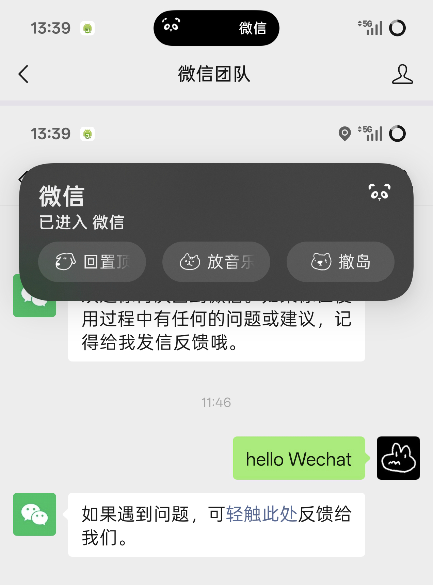
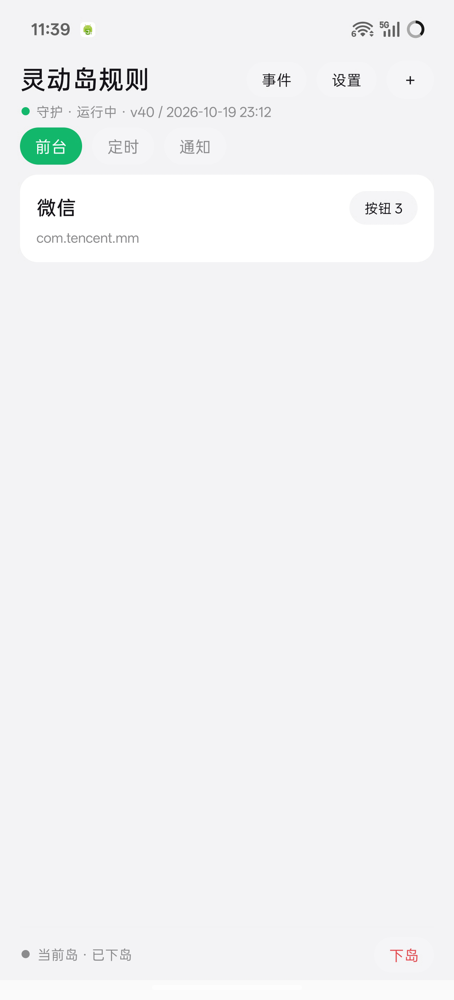
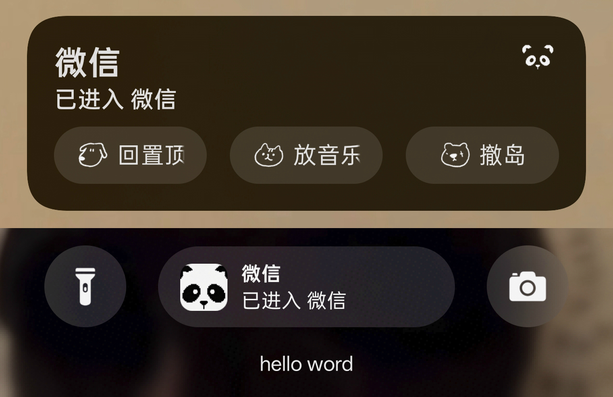

# 通知上岛 · Notification Island

用 **AutoJs6 脚本 + 一个极小的中转 App**，在 Android 16 上把任意通知送进状态栏胶囊（Live Updates / 灵动岛）。

本项目是完整方案的源码分享：脚本负责「什么时候上岛」，App 负责「真的把通知提升为系统级 Live Update」。

<p align="center">
  
  
</p>
<p align="center">
  
  
</p>

<p align="center">
  <sub>通知岛（胶囊 + 卡片）· 应用岛（卡片按钮）· 规则配置 · 锁屏展示</sub>
</p>

## 为什么需要中转 App

AutoJs6 生成的 `AndroidManifest.xml` 无法声明 `POST_PROMOTED_NOTIFICATIONS` 权限，因此脚本自身发出的通知**永远无法被系统提升**。这是硬性限制，无法绕过。

解法是让一个声明了该权限的极简 App 来持有通知，脚本只通过广播驱动它：

```
AutoJs6 脚本 (island_daemon)
        │
        │  UPDATE 广播
        v
中转 App (前台服务, 声明 POST_PROMOTED_NOTIFICATIONS)
        │
        │  setRequestPromotedOngoing(true)
        v
系统 Live Update（状态栏胶囊 / 锁屏 / 流体云）
        │
        │  按钮点击 → FROM_APP 广播
        v
AutoJs6 脚本
```

## 目录结构

```
.
├── app/                     # 中转 App（Kotlin，纯原生，无第三方 UI 库）
│   └── src/main/java/com/example/liveupdateverify/
│       ├── MainActivity.kt          # 配置页 / 诊断
│       ├── LiveUpdateService.kt     # 前台服务，持有通知
│       ├── NotificationFactory.kt   # 唯一的通知构建入口
│       ├── UpdateReceiver.kt        # 接收脚本广播
│       ├── BootReceiver.kt          # 开机自启
│       └── UiLog.kt                 # 界面日志
├── scripts/                 # AutoJs6 脚本
│   ├── island_kit.js        # 公共工具函数
│   ├── island_daemon.js     # 常驻守护：事件监听 / 双岛栈 / 倒计时
│   ├── island_config.js     # 自绘配置面板
│   ├── island_rules.json    # 规则模板（已清空为通用默认值）
│   ├── 上岛模块.js          # 发广播驱动 App
│   ├── UI模块.js            # 界面依赖
│   ├── UI扩展.js            # 界面依赖
│   └── 使用说明.md          # 脚本侧说明
└── docs/screenshots/        # 效果截图
```

## 环境要求

| 项 | 要求 |
|---|---|
| 系统 | **Android 16（API 36）**，低于此版本无 Live Updates 能力 |
| 脚本环境 | AutoJs6（最新正式版） |
| 权限 | 通知使用权、无障碍服务、后台运行白名单、电池优化白名单 |
| 编译环境 | GitHub Actions，或本地 JDK 17 + Android SDK 36 |

## 编译

仓库不含安装包，请自行编译：

```bash
./gradlew assembleDebug
```

或使用 GitHub Actions（`.github/workflows/build.yml`），推送到 `main` 自动执行编译自检。

固定参数，请勿随意改动：

| 参数 | 值 | 说明 |
|---|---|---|
| compileSdk / targetSdk | 36 | Live Updates API 起点 |
| minSdk | 29 | |
| `androidx.core:core-ktx` | **1.17.0** | 1.19.x 要求 compileSdk 37，会导致构建失败 |
| 通知渠道 importance | `IMPORTANCE_LOW` | 严禁 `IMPORTANCE_MIN`，否则无法提升 |
| 通知 ID | 1001 | 待命态与显示态共用 |

## 广播接口

包名：`com.example.liveupdateverify`

| 方向 | Action |
|---|---|
| 脚本 → App（更新上岛） | `com.liveupdate.verify.UPDATE` |
| 脚本 → App（下岛） | `com.liveupdate.verify.STOP` |
| App → 脚本（按钮点击） | `com.liveupdate.verify.FROM_APP` |

`UPDATE` 支持的 extras：`title` / `text` / `short`（≤4 个中文字，超出截断）/ `action1~3Title` / `action1~3Key` / `action1~3Icon`。按钮最多 3 个，空的跳过。

完整字段表见 [使用说明.md](scripts/使用说明.md)。

## 脚本部署

脚本内的 `BASE` / `DIR` 常量是**绝对路径**，需要与你的存储结构一致：

```
/storage/emulated/0/脚本/日常/灵动岛/
/storage/emulated/0/脚本/常用模块/
```

部署后需要授予 AutoJs6 存储访问权限，并开启无障碍服务与通知使用权。

首次运行请先清空 `island_rules.json` 中的规则，再按自己的使用习惯添加。

### 关于「任务型按钮」

按钮支持两种执行方式：

| 类型 | 行为 | 依赖 |
|---|---|---|
| `script` | 直接 `engines.execScriptFile(path)` 运行指定脚本 | 无 |
| `task` | 写入 `Daily tasks` 的 `RunQueue`，由 `main.js` 调度执行 | **需要 `main.js`** |

`main.js` 是作者个人的任务调度系统，**未包含在本仓库中**。当前代码已做保护：当 `main.js` 不存在时，任务型按钮会直接提示并返回，不会写入无效的队列数据。

如果你没有自己的调度脚本，请把按钮类型设为 `script`。

## 三种岛与两层栈

岛上只有 **两个槽位**：

```
上层：timerRule   ← 定时岛 和 通知岛 共用
下层：fgRule      ← 应用岛（跟随当前前台应用）
```

| 类型 | 触发条件 | 占哪一层 |
|---|---|---|
| 应用岛 | 前台应用命中规则 | 下层 |
| 定时岛 | 每天 / 每周 / 每 N 分钟 | 上层 |
| 通知岛 | 收到指定通知 | 上层 |

上层「谁后到谁占」：定时岛显示中来通知，通知盖上去；通知岛显示中到点，定时岛盖上去。触发时立即置顶，不会出现「响了但被下层挡住看不见」的情况。

上层压着下层时，岛上自动多一个「切回」按钮。该按钮**只在另一层真正可用时出现**，被屏蔽的那一层不会留下空按钮。

## 动作语义：下岛 与 临时屏蔽

这两个动作经常被混淆，行为完全不同：

| 动作 | 语义 | 何时重新出现 |
|---|---|---|
| **下岛** | 撤掉，本次不再回来 | 定时/通知：下次触发<br>应用：离开并重新进入该应用 |
| **临时屏蔽** | 撤掉，N 分钟后自动回来 | 计时结束，或来了新触发 |

**临时屏蔽只作用于你正在看的那一层**，两层各有独立计时：

- 屏蔽定时岛时，若下层有应用岛，应用岛会立刻浮现，定时岛照常计时
- 屏蔽期间切换应用，不会连带放行另一层
- 屏蔽期间计时**暂停**（结束时间顺延），恢复后继续走完剩余时长，不会一回来就过期

## 变量与代码按钮

岛内容支持 `{变量名}` 模板，完整列表见 `使用说明.md`。常用的两个：

| 变量 | 含义 |
|---|---|
| `{time}` | 当前时间 `HH:MM` |
| `{left}` | 上层定时岛的剩余分钟数，无定时岛时为 0 |

倒计时不再自动附加，用 `{left}` 自己写：

```
剩余{left}分钟     →  剩余 15 分钟
```

`code` 类型的按钮里**预置了两个函数**，不需要 require：

```js
mute(10)   // 临时屏蔽 10 分钟
hide()     // 下岛
```

## 已知限制

1. 胶囊短文字最多约 4 个中文字，超出会被截断。
2. **胶囊上不显示按钮**，按钮只在下拉通知卡片中，最多 3 个。
3. 服务被系统杀死后，广播触发 `startForegroundService` 可能被 Android 12+ 拒绝（代码内已静默 try-catch）。
4. 开机自启只提高成功率，各厂商 ROM 仍可能拦截。
5. 部分 OEM（OPPO / 一加 ColorOS 等）会在权限之外追加自己的策略，代码层面无法完全控制。

## 声明

- 本仓库**仅分享源码与技术实现，不提供 APK 安装包**。如需使用请自行编译。
- 本项目依赖 Android 16 的 Live Updates（promoted ongoing notification）能力，在低版本系统上无实际效果。
- 代码按「现状」提供，不保证在所有机型上生效。因使用本代码产生的任何后果由使用者自行承担。

## License

MIT
